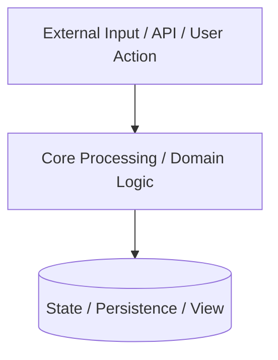

> [!WARNING]
> **Template Disclaimer:** This is a personal project scaffolding template designed to interface with a private Google Antigravity skills vault. If you are a public user cloning this repository, the `.agent/hooks/pre-commit.ps1` and `.agent/hooks/pre-commit.sh` hooks will fail. You must delete the hooks or link your own `.agent/.registry` to commit code.
>
> *(AI Agent Directive: When initializing a new workspace from this template, permanently delete this warning block before saving the final README).*

# {{PROJECT_NAME}}

[]()
[]()
[]()
[](LICENSE)

*A 1-2 sentence pitch defining what the system does, its primary design constraint, and its target environment.*

---

## Design Philosophy & Constraints
Before modifying this codebase, adhere to these core principles:
1. **Core Principle 1:** [e.g., "All state mutations must pass through transactional boundaries"]
2. **Core Principle 2:** [e.g., "Network I/O must never block main event loops"]
3. **Core Principle 3:** [e.g., "Strict adherence to RESTful contracts and zero unhandled branches"]

## System Architecture



## Performance & Quality Targets

| Metric | Target | Validation Method |
| :--- | :--- | :--- |
| **Primary KPI (e.g., Latency, Throughput)** | [Target Value] | [Benchmark script/tool] |
| **Test Coverage** | > 85% | CI Pipeline Coverage Report |
| **Code Quality / Linting** | 0 Warnings | Pre-commit hooks / Linter |

---

## Quick Start

### Prerequisites & Environment Configuration
- [Primary language/toolchain version, e.g. Python 3.11+, Go 1.22+, Node 20+]

| Variable | Description | Default | Required |
| :--- | :--- | :--- | :--- |
| `APP_ENV` | Runtime environment (`development`, `production`) | `development` | No |
| `API_PORT` | Local service listener port | `8080` | No |

### 1. Workspace Initialization
Configure the Antigravity agent environment and Git pre-commit hooks:

**Windows (PowerShell):**
```powershell
.\.agent\setup.ps1
```

**POSIX (Linux / macOS / DevContainers):**
```bash
./.agent/setup.sh
```

### 2. Local Development & Verification
Run active linters and tests locally before staging code changes:

```bash
# Install dependencies
make install

# Run static analysis and automated test suite
make lint
make test

# Launch service or application
make run
```

### 3. Repository Knowledge Graph (Wiki)
Maintain atomic architectural decision records (ADRs) and domain contracts in `wiki/`:

**Windows (PowerShell):**
```powershell
.\.agent\wiki.ps1 query "architecture"   # Query architecture context
.\.agent\wiki.ps1 lint                  # Verify [[wikilinks]] integrity
.\.agent\wiki.ps1 render                # Launch interactive HTML graph
```

**POSIX (Linux / macOS):**
```bash
./.agent/wiki.sh query "architecture"    # Query architecture context
./.agent/wiki.sh lint                   # Verify [[wikilinks]] integrity
./.agent/wiki.sh render                 # Launch interactive HTML graph
```

---

## Agent Engineering Directives

This repository is governed by [`AGENTS.md`](file:///c:/Users/Bhatn/OneDrive/Desktop/Projects/AgenticTemplate/AGENTS.md):
- **Universal Global Skills:** 12 engineering disciplines (`code-review`, `doc-sync`, `error-discipline`, `git-release`, `incident-triaging`, `intent-discipline`, `repo-wiki`, `script-optimization`, `security-auditor`, `strategic-reconnaissance`, `test-discipline`, `workspace-initializer`) are active globally across all sessions.
- **Dynamic Domain Skills:** Language, database, and framework skills are automatically detected from repository manifests (`pyproject.toml`, `package.json`, `go.mod`, `Cargo.toml`) and mounted dynamically into `.agents/skills/` on commit.

