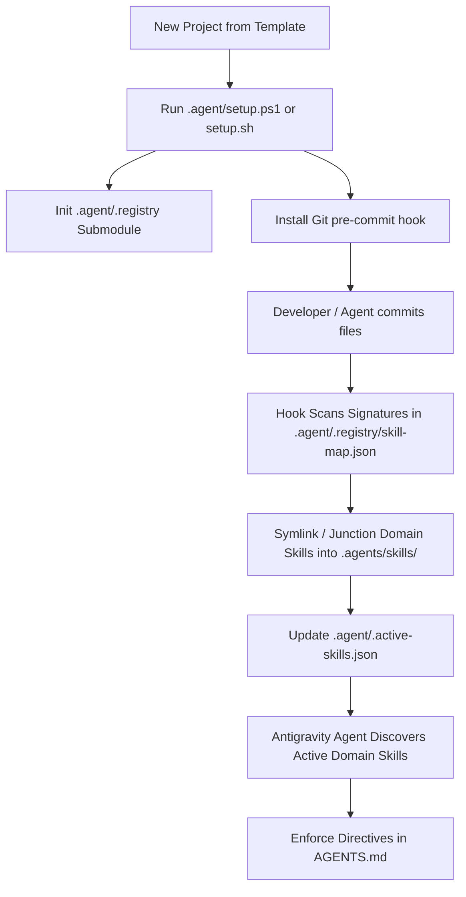

> [!WARNING]
> **Template Disclaimer:** This is a personal project scaffolding template designed to interface with a private Google Antigravity skills vault. If you are a public user cloning this repository, the `.agent/hooks/pre-commit.ps1` and `.agent/hooks/pre-commit.sh` hooks will fail. You must delete the hooks or link your own `.agent/.registry` to commit code.
>
> *(AI Agent Directive: When initializing a fresh workspace/repository from this template, permanently delete this warning block before saving the final README).*

# AgenticTemplate

[]()
[]()
[]()
[](LICENSE)

An opinionated, agent-first repository scaffolding template for **Google Antigravity**. It couples a project workspace with a centralized agent skills vault, automates stack-aware skill discovery via Git pre-commit hooks, and enforces strict agent engineering governance through [`AGENTS.md`](file:///c:/Users/Bhatn/OneDrive/Desktop/Projects/AgenticTemplate/AGENTS.md).

---

## Architecture & Lifecycle



---

## Core Capabilities

- **Automated Stack & Skill Discovery**:
  When files are committed, `.agent/hooks/pre-commit.ps1` (or POSIX `.agent/hooks/pre-commit.sh`) scans the repository for language and framework markers (e.g., `go.mod`, `package.json`, `Cargo.toml`, `requirements.txt`). It automatically symlinks matching domain skills from `.agent/.registry` into `.agents/skills/` (Antigravity's native workspace customization root).
- **Zero-Friction Windows & POSIX Support**:
  Hooks and setup scripts seamlessly handle Windows Developer Mode symlinks with automatic fallback to NTFS directory junctions (`mklink /J`), alongside standard POSIX symlinks (`ln -s`) for Linux, macOS, and DevContainers.
- **Strict Agent Governance**:
  [`AGENTS.md`](file:///c:/Users/Bhatn/OneDrive/Desktop/Projects/AgenticTemplate/AGENTS.md) defines explicit protocol steps for AI coding agents on initialization: verifying Git hooks, running initial skill discovery, keeping context windows lean, and requiring testing/linting before staging code changes.
- **Clean Root Architecture**:
  Orchestration scripts, submodules, hook triggers, and manifest state live encapsulated under `.agent/`, while IDE customization discovery lives in [`.agents/skills/`](file:///c:/Users/Bhatn/OneDrive/Desktop/Projects/AgenticTemplate/.agents/skills).
- **In-House Repository Knowledge Graph**:
  Built-in support for atomic documentation, architecture decision records (ADRs), and bidirectional wikilinks in `wiki/`. Verified via pre-commit linting to ensure zero dead links. Subgraph queries and interactive HTML graph visualization powered by the zero-dependency `.agent/wiki.ps1` (or `wiki.sh`) tool.

---

## Directory Structure

```text
AgenticTemplate/
├── .agent/
│   ├── .registry/             # Git submodule: centralized agent-skills-vault
│   ├── hooks/
│   │   ├── pre-commit.ps1     # Submodule auto-sync & skill detection (PowerShell)
│   │   └── pre-commit.sh      # Submodule auto-sync & skill detection (POSIX sh)
│   ├── wiki.ps1               # Quick CLI launcher for wiki-engine (Windows)
│   ├── wiki.sh                # Quick CLI launcher for wiki-engine (Linux/macOS)
│   ├── .active-skills.json    # Manifest of currently active workspace skills
│   ├── setup.ps1              # One-command workspace bootstrap & hook installer (Windows)
│   └── setup.sh               # One-command workspace bootstrap & hook installer (Linux/macOS)
├── .agents/
│   └── skills/                # Antigravity customization discovery root (symlinks gitignored)
│       └── .gitkeep
├── wiki/                      # Repository Knowledge Graph & ADRs (Markdown)
│   ├── index.md               # Root knowledge graph entrypoint
│   ├── architecture.md        # High-level architecture specification
│   └── adr/                   # Architecture Decision Records
│       └── 001-initial-architecture.md
├── AGENTS.md                  # Antigravity agent directives & bootstrap protocol
├── README.example.md          # Scaffolding template README for downstream projects
├── README.md                  # System documentation for AgenticTemplate
├── .gitattributes             # Git normalization (LF line endings for scripts)
├── .gitmodules                # Submodule registration for .agent/.registry
└── .gitignore                 # Standard ignores for build outputs & dynamic links
```

---

## Quick Start

### 1. Initialize Workspace
Run the automated setup script from PowerShell (Windows):

```powershell
.\.agent\setup.ps1
```

Or from a POSIX shell (Linux/macOS/DevContainers):
```bash
./.agent/setup.sh
```

The setup script will:
1. Ensure the workspace is a valid Git repository and set the root directory.
2. Initialize and pull the `.agent/.registry` submodule from the skills vault.
3. Configure the Git `.git/hooks/pre-commit` hook to run synchronization on every commit.
4. Execute an immediate initial synchronization pass into `.agents/skills/`.

### 2. Fresh Repository Setup & Cleanup
When scaffolding a new application from this template into a fresh repository:
1. **Remove Template Disclaimer**:
   - Permanently delete the `> [!WARNING]` block at the very top of [`README.md`](file:///c:/Users/Bhatn/OneDrive/Desktop/Projects/AgenticTemplate/README.md).
   - Alternatively, replace [`README.md`](file:///c:/Users/Bhatn/OneDrive/Desktop/Projects/AgenticTemplate/README.md) entirely using [`README.example.md`](file:///c:/Users/Bhatn/OneDrive/Desktop/Projects/AgenticTemplate/README.example.md) as your starter specification, and delete [`README.example.md`](file:///c:/Users/Bhatn/OneDrive/Desktop/Projects/AgenticTemplate/README.example.md).
2. **Private Skills Vault Check**:
   - If you do not have access to the private `agent-skills-vault`, either link your own submodule to `.agent/.registry` or remove `.agent/hooks/` and the pre-commit hook triggers.
3. **Populate Stack & Commit**:
   - Add your application source code and stack manifest files (e.g., `package.json`, `go.mod`, `Cargo.toml`, `requirements.txt`).
   - Commit your changes—the pre-commit hook will automatically detect your project stack and symlink matching domain skills into [`.agents/skills/`](file:///c:/Users/Bhatn/OneDrive/Desktop/Projects/AgenticTemplate/.agents/skills).

---

## Global Skills vs. Workspace Domain Skills

Antigravity operates with a two-tier skill model:

1. **Global Skills** (`~/.gemini/config/skills/`):
   Always available across all workspaces on the machine (`code-review`, `doc-sync`, `error-discipline`, `git-release`, `incident-triaging`, `intent-discipline`, `repo-wiki`, `script-optimization`, `security-auditor`, `strategic-reconnaissance`, `test-discipline`, `workspace-initializer`). These are never linked into `.agents/skills/`.
2. **Workspace Domain Skills** (`.agents/skills/`):
   Language-, framework-, and stack-specific skills (e.g., `go`, `react`, `rust`, `python`) dynamically linked from the vendored `.agent/.registry` based on active repository files.
