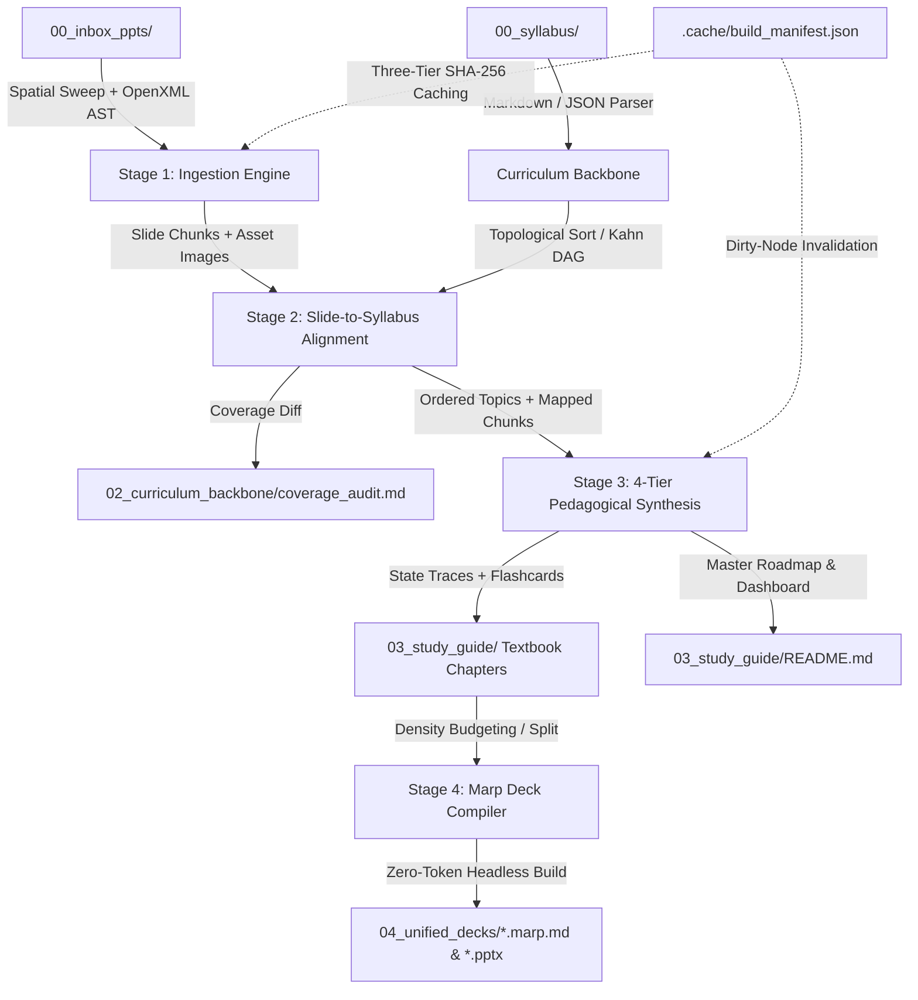

# Distill

[]()
[]()
[]()
[]()
[](LICENSE)

A **Map-Reduce & Knowledge-Graph Synthesis Pipeline** that compiles fragmented PowerPoint lecture decks (`.pptx`) and term syllabi into comprehensive, first-principles textbook study guides and auto-paginated presentation decks.

---

## Architecture & Pipeline Flow



---

## Core Capabilities

1. **Multimodal Ingestion (Zero-Token Layout & Diagram Preservation):**
   - **Anti-Scramble Spatial Sweep:** Sorts OpenXML shapes by `(top // line_threshold, left)` coordinates before serialization, eliminating z-order scrambling in multi-column slides.
   - **OpenXML AST Connector Transpiler:** Inspects `<p:cxnSp>` connector tags deterministically to emit native Mermaid flowcharts with zero token burn and sub-millisecond execution.
   - **Merged Table Normalizer:** Resolves row and column cell spans into clean GitHub-Flavored Markdown tables.
   - **High-Resolution Asset Carver:** Carves embedded figures and diagrams to `01_raw_markdown/assets/` with SHA-256 binary digests.
   - **Deterministic Scrubber:** Strips slide footers, course headers, page numbering, and transition filler slides ("Any Questions?", "Agenda").

2. **Top-Down Syllabus Alignment & Kahn's DAG Sorter:**
   - Ingests the course syllabus as the ground-truth curriculum backbone, eliminating fuzzy unsupervised topic guesswork.
   - Executes Kahn's Algorithm to topologically sort prerequisite topic chains, ensuring concepts are sequenced in strict pedagogical order.
   - Automatically generates `02_curriculum_backbone/coverage_audit.md` flagging syllabus topics with zero slide coverage ("Whiteboard Lectures").

3. **4-Tier Pedagogical Chapter Synthesis:**
   - Synthesizes publication-grade textbook chapters in `03_study_guide/`:
     - **Header:** Interactive Syllabus Mastery Checklist (`- [x]`) and canonical synonym alignment.
     - **Tier 1 (First-Principles Intuition):** Explains *why* the concept exists and the fundamental problem it solves before introducing jargon.
     - **Tier 2 (Formal Theory & Derivation):** Complete mathematical, algorithmic, and protocol invariants with zero skipped intermediate steps.
     - **Tier 3 (Worked Examples with State Traces):** Concrete step-by-step state-transition matrices showing memory and buffer states per step, alongside embedded slide figures (``).
     - **Tier 4 (Edge Cases & Exam Traps):** Network partitions, crash recovery guarantees, and concurrency pitfalls.
     - **Active Recall Flashcard Deck:** High-yield Q&A pairs for spaced repetition testing.

4. **Zero-Token Presentation Compilation:**
   - Generates unified revision decks using **Marp** (`theme: gaia`).
   - Enforces strict slide density ceilings (1 title, max 4 bullets, max 65 characters/line, 1 diagram) with automated pagination splitting (`---`) to prevent vertical text overflow.
   - Injects speaker context into `<!-- _notes: ... -->` comments for verbal self-testing in Marp Presenter Mode (`P` key).

5. **Incremental Three-Tier Build Manifest:**
   - Governed by `.cache/build_manifest.json` tracking source hashes across Decks -> Slide Chunks -> Topics.
   - Updates are written atomically via `.tmp` file renames to prevent cache corruption upon interruption.

---

## Directory Structure

```text
distill/
├── 00_syllabus/                 # Drop syllabus.md / syllabus.json here
├── 00_inbox_ppts/               # Drop raw .pptx lecture decks here
├── 01_raw_markdown/             # Spatially ordered slide markdown chunks
│   └── assets/                  # Extracted high-resolution slide figures
├── 02_curriculum_backbone/      # Syllabus DAG, alignment matrix, and coverage audit
│   └── coverage_audit.md        # Report: Covered topics vs whiteboard lecture gaps
├── 03_study_guide/              # The core output
│   ├── README.md                # Course dashboard, roadmap, and cheat sheet
│   ├── 01_topic_alpha.md        # 4-tier textbook chapter with state traces
│   └── 02_topic_beta.md
├── 04_unified_decks/            # Auto-paginated Marp decks (.marp.md / .pptx)
├── .cache/                      # Incremental build manifest (.cache/build_manifest.json)
├── src/distill/                 # Core Python package
│   ├── models/                  # Pydantic data contracts (slides, syllabus, manifest)
│   ├── ingest/                  # Spatial sweep, OpenXML AST, tables, asset carver
│   ├── cluster/                 # Syllabus parser, Kahn DAG sorter, aligner, audit
│   ├── synthesize/              # 4-tier pedagogical chapter & index generators
│   ├── compile/                 # Marp density budgeting, auto-pagination, compiler
│   ├── pipeline.py              # Master incremental pipeline coordinator
│   └── cli.py                   # Click & Rich CLI entrypoint
└── tests/                       # Comprehensive pytest suite (18 unit tests)
```

---

## Quick Start

### 1. Installation
Install dependencies via `uv`:

```powershell
uv venv
uv pip install -e ".[dev]"
```

### 2. Usage Workflow

1. Drop your course syllabus into `00_syllabus/syllabus.md`.
2. Drop your lecture presentations into `00_inbox_ppts/`.
3. Run the complete distillation pipeline:

```powershell
uv run distill run
```

Or execute individual stages:

```powershell
# Stage 1: Ingest slide chunks and carve images
uv run distill ingest

# Stage 2: Audit syllabus coverage and identify whiteboard gaps
uv run distill audit

# Stage 3 & 4: Synthesize 4-tier study guide chapters
uv run distill synthesize

# Stage 5: Compile Marp presentation decks
uv run distill compile
```

### 3. Running Tests

```powershell
uv run pytest
uv run ruff check src tests
```
